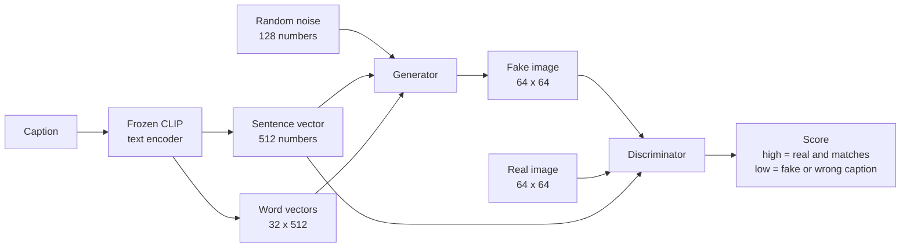
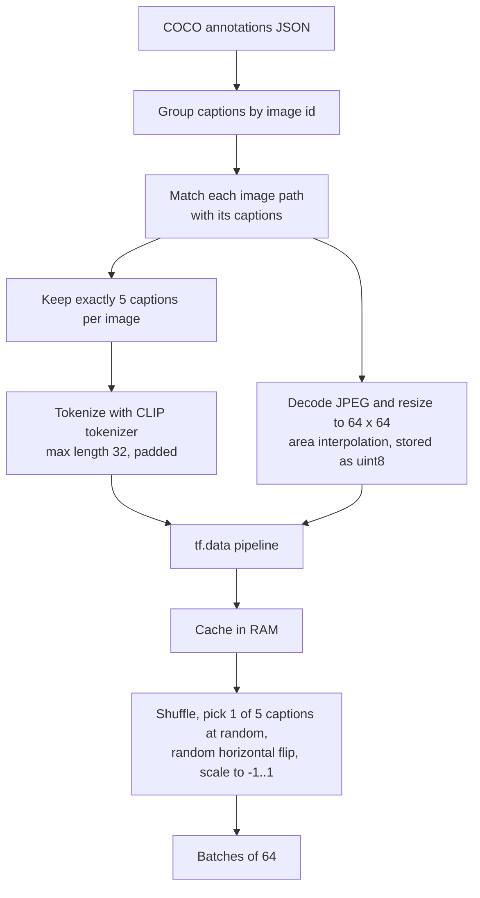
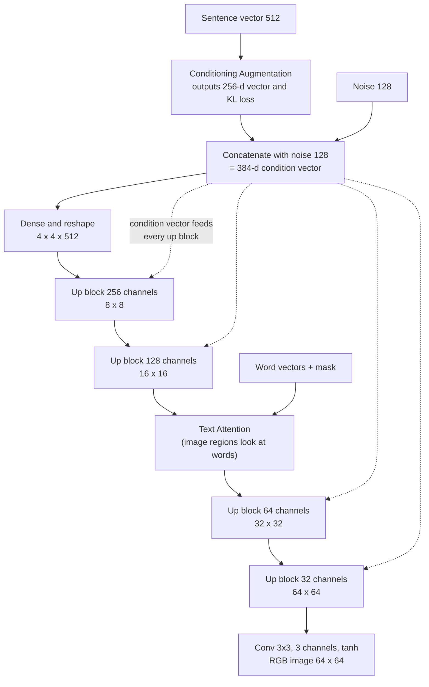
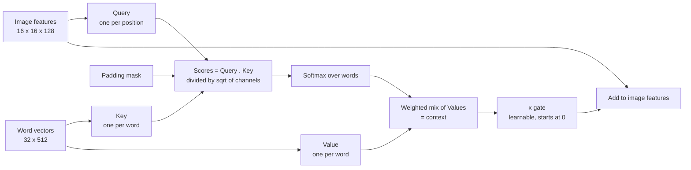
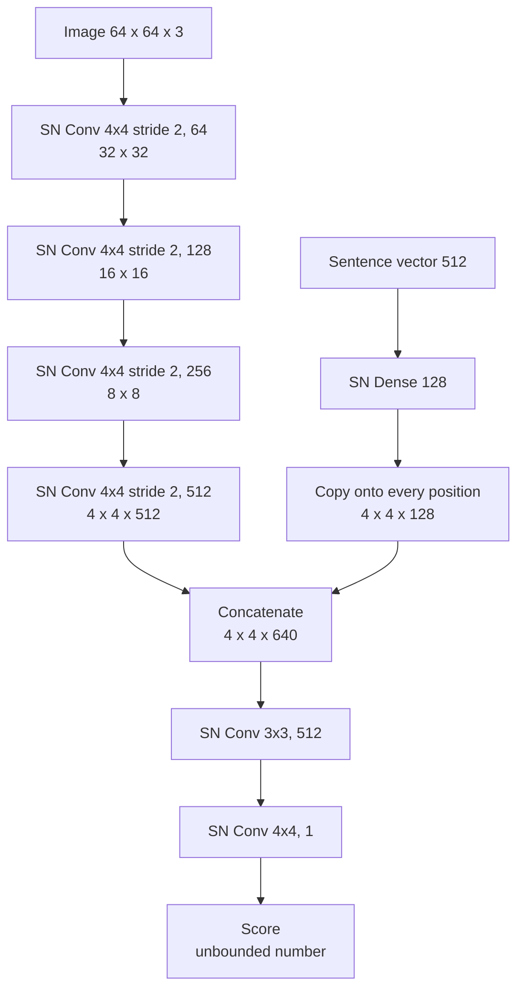
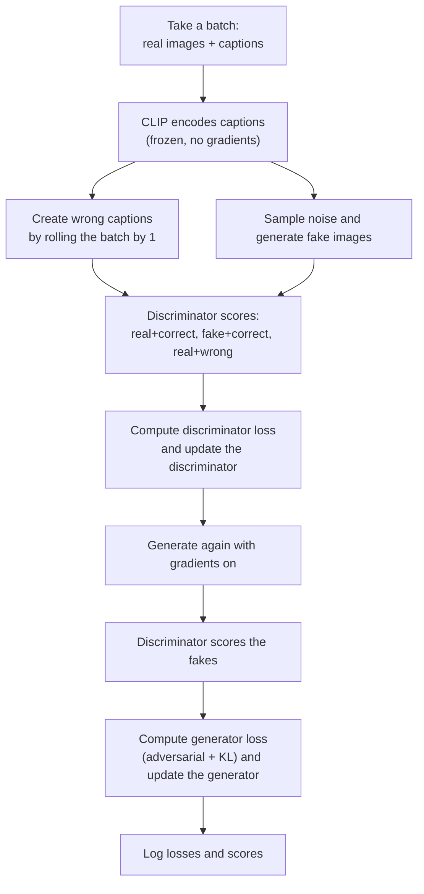

# Text-to-Image GAN with CLIP Conditioning

A conditional GAN built in **TensorFlow / Keras** that generates **64×64 images from text captions**, trained on the **MS COCO 2017** dataset.

The model combines a frozen **CLIP text encoder**, a generator with **text-conditioned normalization and word-level attention**, and a **spectral-normalized discriminator** that is also trained to reject real images paired with the wrong caption.

<p align="center">
  
  <br>
  <em>Generated samples on a fixed set of captions (same noise at every epoch).</em>
</p>

---

## Table of Contents

1. [The idea in one minute](#1-the-idea-in-one-minute)
2. [Full pipeline](#2-full-pipeline)
3. [Dataset and preprocessing](#3-dataset-and-preprocessing)
4. [Text encoding with CLIP](#4-text-encoding-with-clip)
5. [Generator](#5-generator)
6. [Discriminator](#6-discriminator)
7. [Why spectral normalization?](#7-why-spectral-normalization)
8. [Loss functions](#8-loss-functions)
9. [Training procedure](#9-training-procedure)
10. [Hyperparameters](#10-hyperparameters)
11. [Monitoring training](#11-monitoring-training)
12. [Results](#12-results)
13. [Planned experiments](#13-planned-experiments)
14. [Limitations](#14-limitations)
15. [How to run](#15-how-to-run)
16. [References](#16-references)

---

## 1. The idea in one minute

Think of a **forger** and a **detective**.

| Role | Network | Job |
|---|---|---|
| Forger | **Generator** | Draw a picture that matches a caption |
| Detective | **Discriminator** | Look at a picture **and** a caption and give a score: *real and matching* or *fake / not matching* |

They train against each other. Every time the detective catches a fake, the forger learns what to fix. Every time the forger fools the detective, the detective learns what to look for. After many rounds the generator produces images that look real and follow the caption.

---

## 2. Full pipeline



**Why random noise?** A network with the same input always gives the same output. The caption decides *what* to draw and the noise decides the *details* (colours, pose, background), so one caption can give many different images. If the generator ignores the noise, that is called **mode collapse**.

---

## 3. Dataset and preprocessing

**Dataset:** MS COCO 2017: about 118,000 training images and 5,000 validation images, each with about 5 human-written captions.



| Step | What it does | Why |
|---|---|---|
| Resize to 64×64 | Shrinks every photo with area interpolation | Much faster training and less memory |
| Store as `uint8` | 1 byte per value instead of 4 | The whole dataset fits in RAM cache (about 1.4 GB) |
| 5 captions per image | Extra captions are dropped, missing ones are repeated | Keeps the arrays rectangular |
| Random caption each time | One of the 5 is picked every time an image is seen | More text variety from the same image |
| Random horizontal flip | Mirrors the image half the time | Cheap data augmentation |
| Scale to [-1, 1] | `pixel / 127.5 - 1` | Matches the generator's `tanh` output |
| Padding mask | 1 for real tokens, 0 for padding | Lets attention ignore the padding |

---

## 4. Text encoding with CLIP

Neural networks cannot read words, so captions are converted to numbers with the text half of **CLIP** (`openai/clip-vit-base-patch32`).

CLIP is **frozen** (`trainable = False`, plus `tf.stop_gradient`). It is already trained on hundreds of millions of image-caption pairs, and the noisy GAN gradients would only damage what it knows.

It gives two outputs:

| Output | Shape | Meaning | Used by |
|---|---|---|---|
| **Sentence vector** (`pooler_output`) | `512` | Summary of the whole caption | Generator conditioning, discriminator |
| **Word vectors** (`last_hidden_state`) | `32 × 512` | One vector per word | Word-level attention in the generator |

---

## 5. Generator

The generator turns `[noise + caption]` into a 64×64 image by starting from a tiny 4×4 feature map and growing it step by step.



### Layer-by-layer

| Stage | Output shape |
|---|---|
| Noise + sentence condition | `384` |
| Dense + reshape | `4 × 4 × 512` |
| Up block (256) | `8 × 8 × 256` |
| Up block (128) | `16 × 16 × 128` |
| **Text attention** | `16 × 16 × 128` |
| Up block (64) | `32 × 32 × 64` |
| Up block (32) | `64 × 64 × 32` |
| Conv 3×3 + tanh | `64 × 64 × 3` |

### 5.1 Up block

Each up block does:

```
UpSampling2D  →  Conv 3x3  →  BatchNorm (no scale/shift)  →  TextAffine  →  LeakyReLU(0.2)
```

The batch norm has its own scale and shift removed on purpose. The **TextAffine** layer supplies them instead, computed from the caption (see 5.3). This is a form of *conditional normalization*, so the text influences every resolution.

### 5.2 Conditioning Augmentation

Instead of feeding the exact sentence vector, the layer predicts a **mean** (`mu`) and a **spread** (`logvar`) and samples a random point near the sentence's meaning:

```
condition = mu + exp(0.5 * logvar) * epsilon        (epsilon ~ N(0, 1))
```

*Why?* COCO has only about 5 captions per image. A pin on a map (the exact vector) lets the generator memorise. A circle on a map (a random point near it) forces it to learn the *general meaning*, and it also adds variety.

**KL loss.** Without a restriction the layer could shrink the circle to a dot, which removes the randomness. A KL divergence term keeps the distribution close to a standard normal, like a leash:

$$L_{KL} = -\tfrac{1}{2}\,\mathrm{mean}\left(1 + \log\sigma^2 - \mu^2 - \sigma^2\right)$$

It is added to the generator loss with `kl_weight = 0.1`. Too high and the model ignores the caption. Too low and the randomness collapses.

### 5.3 TextAffine (text-conditioned scale and shift)

Two small dense layers read the condition vector and produce `gamma` and `beta`:

```
output = x * (1 + gamma) + beta
```

The weights start at zero, so at the start this layer does nothing (`x * 1 + 0`) and training begins stably. The caption then adjusts the feature maps at every resolution.

### 5.4 Text Attention

At the 16×16 stage, every position in the image looks at the caption's individual words and decides which ones matter for it. For example, a spot near the top of the picture can focus on "blue sky" and a spot near the bottom on "green field".



- **Masking:** padding words get a very negative score (`-1e9`), so their weight after softmax is practically zero.
- **Gate starting at 0:** at the start `output = features + 0 * context`, so the layer is an identity. The generator learns the basics first, and the gate grows later if attention turns out to be useful.

---

## 6. Discriminator

The discriminator receives a **64×64 image** and the **sentence vector**, and returns a single score.



`SN` means the layer uses **spectral normalization** (written by hand, so no `tensorflow_addons` is needed). All activations are LeakyReLU(0.2).

**The score is not a probability.** It is an unbounded number (hinge loss is used, not sigmoid). High means "real and matches the caption", low means "fake or mismatched".

---

## 7. Why spectral normalization?

**The problem.** The generator learns only from the discriminator's score. If the discriminator becomes too sharp, a tiny change in the image makes a huge change in the score, and the generator gets useless or exploding gradients. GAN training then becomes unstable.

**An analogy.** A harsh teacher gives 0 or 100 and swings wildly for tiny differences, so the student cannot see what to fix. A smooth teacher gives 40, then 45, then 50 as the work improves. Spectral normalization turns the discriminator into the smooth teacher.

**How it works.** Every layer multiplies its input by a weight matrix `W`, and some matrices stretch inputs a lot:

```
W = [[3, 0],        input (1.0, 1.0)  →  output (3.0, 1.0)
     [0, 1]]        input (1.1, 1.0)  →  output (3.3, 1.0)     a 0.1 change became 0.3
```

Stacking many such layers multiplies the stretching. The fix:

1. Find the **largest stretch** of the layer, called the largest singular value $\sigma(W)$ (here, 3).
2. Divide the weights by it:

$$\bar{W} = \frac{W}{\sigma(W)}$$

3. Now the layer can never stretch anything by more than 1, so the whole discriminator is **1-Lipschitz** (smooth).

**Making it cheap.** Computing $\sigma(W)$ exactly every step is slow, so it is estimated with **power iteration**: a stored vector `u` is pushed through the weights once per step and gets closer to the direction of maximum stretch as training continues. That is why `u` is stored as a non-trainable weight.

> Spectral normalization normalizes the **weights** by their largest singular value. It is different from batch normalization, which normalizes the **activations** using mean and variance.

---

## 8. Loss functions

### 8.1 The three cases the discriminator sees

| # | Image | Caption | Target score |
|---|---|---|---|
| 1 | Real | Correct | **High** |
| 2 | Generated | Correct | **Low** |
| 3 | Real | **Wrong** (caption of another image in the batch) | **Low** |

Case 3 is the key idea. Without it, the discriminator could only ask "does this look like a real photo?" and ignore the caption, so the generator would never learn to follow the text. With case 3, an image has to be realistic **and** match its caption.

Wrong captions are made cheaply by shifting the batch by one position (`tf.roll`).

### 8.2 Hinge loss

$$L_D = \mathbb{E}\big[\max(0,\,1 - D(x, c))\big] + 0.5\Big(\mathbb{E}\big[\max(0,\,1 + D(G(z, c), c))\big] + \mathbb{E}\big[\max(0,\,1 + D(x, c_{wrong}))\big]\Big)$$

$$L_G = -\,\mathbb{E}\big[D(G(z, c), c)\big] + \lambda_{KL}\, L_{KL}, \qquad \lambda_{KL} = 0.1$$

The generator tries to **raise** the discriminator's score on its images, while the KL term keeps the text conditioning well behaved.

---

## 9. Training procedure

Each training step does the following:



- One discriminator update, then one generator update, per step.
- **Two learning rates (TTUR):** the discriminator learns faster (`4e-4`) than the generator (`1e-4`), which helps balance the two.
- Adam with `beta_1 = 0.0` and `beta_2 = 0.9`, a common setting for GANs.

**Practical training features**

| Feature | Detail |
|---|---|
| Time limit | Stops itself after 10.5 hours (Kaggle sessions end at 12) |
| Checkpoints | Saved every 5 epochs and restored automatically on restart |
| Samples | A grid of 16 images on fixed captions and fixed noise every 2 epochs |
| Diversity check | Same caption with 8 different noise vectors every 2 epochs |
| NaN guard | Training stops if a loss becomes `NaN` |
| Reproducibility | Fixed seeds for TensorFlow, NumPy and Python |

---

## 10. Hyperparameters

| Parameter | Value |
|---|---|
| Image size | 64 × 64 |
| Batch size | 64 |
| Noise dimension | 128 |
| Caption length | 32 tokens |
| Epochs (max) | 300 |
| Steps per epoch | 500 |
| KL weight | 0.1 |
| Generator learning rate | 1e-4 |
| Discriminator learning rate | 4e-4 |
| Adam betas | (0.0, 0.9) |
| Wrong/fake loss weight | 0.5 each |
| Time limit | 10.5 hours |

---

## 11. Monitoring training

GAN losses are **not a reliable progress signal**: both networks fight each other, so the curves rise and fall even when images improve (and a very low discriminator loss usually means the generator is failing). So progress is checked with:

1. **Fixed-noise sample grids** over epochs, to watch blobs turn into shapes and then objects.
2. **Caption match**: different captions should give clearly different images.
3. **Diversity check**: one caption with different noise should give different images. If all 8 look the same, the generator is ignoring the noise.
4. **Real / fake / wrong scores**: a healthy run keeps real above fake and wrong without any of them running to extreme values.

<p align="center">
  
  <br>
  <em>Diversity check: one caption, eight noise vectors.</em>
</p>

---

## 12. Results

<!-- Replace this section with your own outputs once you have them. -->

**Progress over training** (same captions and same noise every time):

| Early epochs | Middle epochs | Final |
|:---:|:---:|:---:|
|  |  |  |

**Training curves:**

<p align="center">
  
</p>

> Quantitative metrics (FID and CLIP score) are listed under [Planned experiments](#13-planned-experiments).

---

## 13. Planned experiments

Each experiment changes **one** thing, with the same seed, the same fixed captions and noise, and the same number of steps.

| Experiment | Question |
|---|---|
| Center crop vs. squash-resize | Does keeping the original shape improve image quality? |
| Wrong-caption loss on / off | Does the model actually follow the text? |
| Text attention on / off | Does attention help? |
| `kl_weight` = 0, 0.1, 1 | How sensitive is the conditioning? |
| Spectral norm on / off | Is training less stable without it? |
| EMA of generator weights | Does a slowly averaged generator give better samples? |
| **FID** and **CLIP score** | Replace judging by eye with numbers |

---

## 14. Limitations

- **Low resolution:** 64×64 only. Going to 128×128 needs one more up block and much more training time.
- **Aspect ratio:** photos are squashed into a square, which distorts shapes (a center-crop variant is planned).
- **Complex scenes:** COCO scenes contain many objects, which are hard for a small GAN, so outputs are often abstract.
- **Evaluation:** no quantitative metric yet (FID / CLIP score), and quality is judged visually.
- **Training time:** limited by the 12-hour Kaggle GPU session.

---

## 15. How to run

The notebook was developed on **Kaggle** with a GPU.

1. Create a Kaggle notebook and turn on **GPU** and **Internet** (needed to download CLIP).
2. Add the **COCO 2017** dataset (images and `captions_train2017.json` / `captions_val2017.json`) as input.
3. Set the dataset paths (`base_path`) in the notebook's path cell.
4. Run all cells. Samples are written to `/kaggle/working/samples_v2` and checkpoints to `/kaggle/working/checkpoints_v2`.

**Main libraries:** `tensorflow`, `keras`, `transformers`, `numpy`, `matplotlib`

```bash
pip install tensorflow transformers numpy matplotlib
```

**Repository structure**

```
.
├── final.ipynb          # full notebook: data, models, training
├── README.md
└── images/              # sample grids, diversity check, loss curves
```

---

## 16. References

- Zhang et al., *StackGAN: Text to Photo-realistic Image Synthesis with Stacked GANs* (2017), conditioning augmentation
- Miyato et al., *Spectral Normalization for Generative Adversarial Networks* (2018)
- Radford et al., *Learning Transferable Visual Models From Natural Language Supervision* (CLIP, 2021)
- Xu et al., *AttnGAN: Fine-Grained Text to Image Generation with Attentional GANs* (2018)
- Zhang et al., *Self-Attention Generative Adversarial Networks* (2018), hinge loss and zero-initialized gate
- Heusel et al., *GANs Trained by a Two Time-Scale Update Rule Converge to a Local Nash Equilibrium* (2017)
- Lin et al., *Microsoft COCO: Common Objects in Context* (2014)

---

## Author

**Vivek Chauhan**
[GitHub](https://github.com/vivekdj417-sys) · [LinkedIn](https://www.linkedin.com/in/vivek-chauhan-192834343/)

## Acknowledgements

The techniques used here come from the papers listed above. I used AI assistants (Claude) while building and while learning how the architecture works, and I ran and tested the training myself.
